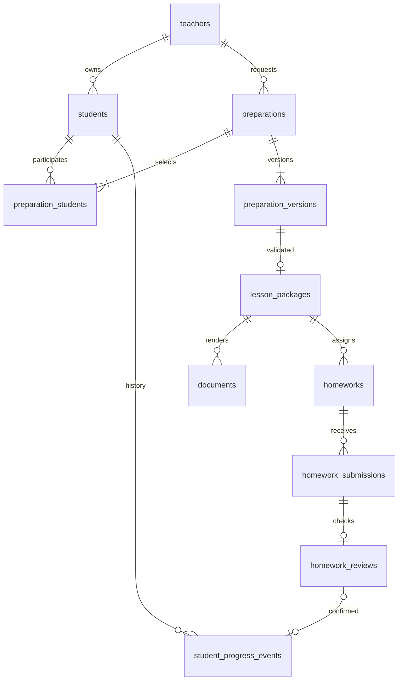

# PostgreSQL: начальная структура

DDL: [001_initial.sql](../migrations/001_initial.sql) и
[002_bot_sessions.sql](../migrations/002_bot_sessions.sql). Бот подключён к PostgreSQL 17
через async psycopg 3: ученики, подтверждённые версии и каждый шаг диалога сохраняются.
`python -m prepa.db.migrate` применяет только отсутствующие миграции, каждую атомарно,
под общей блокировкой мигратора. Compose запускает эту команду перед ботом.
Существующая БД от редактирования уже применённого файла не меняется — добавляйте новую миграцию.

## Сущности и связи



- `teachers`: Telegram user ID, отображаемое имя, дата создания.
- `students`: стабильный student_id, владелец teacher_id, имя, цель, `StudentProfile`
  в JSONB и даты. Один владелец на ученика; совместный доступ нескольких
  преподавателей потребует отдельной модели разрешений.
- `preparations`: запрос преподавателя со стабильным preparation_id.
- `preparation_students`: состав учеников. Составные FK запрещают связать запрос
  с учеником другого владельца; ограничение 1–2 ученика проверяет приложение.
- `preparation_versions`: ключ `(preparation_id, version)`, статус, `LessonBrief`,
  снимок `GenerationContext`, время подтверждения и безопасный код ошибки.
- `lesson_packages`: проверенный `LessonPackage` с review и digest, один на версию.
- `documents`: ссылка на файл, checksum, аудитория teacher/student, получатель,
  Telegram file_id. Один документ данной аудитории на получателя и версию.
  Байты PDF хранятся отдельно, например в объектном хранилище.
- `homeworks`: выданное `Homework` конкретного ученика конкретной версии.
- `homework_submissions`: отдельные попытки сдачи, текст или Telegram file_id,
  статус и исходное сообщение. Уникальная пара chat_id/message_id защищает от
  повторного сохранения сообщения; новая попытка — новая запись.
- `homework_reviews`: результат проверки попытки и подтверждение преподавателя.
  JSON-формат согласовать вместе с будущими HomeworkSubmission/HomeworkCheckResult.
- `student_progress_events`: подтверждённые изменения профиля, состояния до/после.
  Ссылка на проверку опциональна: возможен результат обычного занятия.
- `schema_migrations`: версия применённого SQL.
- `bot_sessions`: состояние мастера ученика/запроса и последние 20 подтверждений.
  Формат состояния имеет собственный format_version, не связанный с версией занятия.

## Контракты и доступ

JSONB хранит общие объекты без вторых Pydantic-моделей. При чтении и записи
использовать `model_validate`/`model_validate_json` из `prepa.schemas`. SQL проверяет
основные ключи, владельцев, статусы и связи, но не заменяет валидацию JSON,
review digest, утверждение преподавателем и предметную оценку.
Документы ученика строятся только из `LessonPackage.for_student`.

Каждый запрос репозитория должен фильтровать teacher_id из доверенного Telegram
контекста, не из текста сообщения. Составные FK защищают целостность владельца,
но **не являются авторизацией чтения**. RLS здесь не настроен. Перед реальными
данными настроить отдельную роль БД с минимальными правами для приложения:
POSTGRES_USER текущего Compose — роль локальной разработки.

Статус `reviewed` означает проверку материалов, не сборку/доставку PDF. Старые
подтверждённые версии не перезаписывать. Изменения профиля или содержания требуют
новой версии и повторного review. `updated_at` обновляется репозиторием явно.

## Транзакции

1. Каждый ввод: загрузка сессии и учеников по teacher_id под `SELECT ... FOR UPDATE`
   строки преподавателя. Сохранение сессии и нового ученика — одна транзакция.
   Ошибка/отмена транзакции не оставляет состояние только в памяти.
2. Подтверждение: проверка владельца всех учеников, запись preparations, участников
   и подтверждённой preparation_versions одновременно с обновлением сессии.
   Черновики живут в bot_sessions. Повторное подтверждение не создаёт вторую версию;
   изменение уже подтверждённого brief запрещено. Генерация возможна только после commit.
3. Результат: проверить LessonPackage, соответствие контексту версии и источникам;
   записать комплект и статус reviewed атомарно. PDF оформлять отдельным шагом.
4. ДЗ: сохранить задания из проверенного комплекта, привязать сдачу к точной
   версии. Чужой ученик или другая подготовка запрещены FK.
5. Прогресс: после утверждения преподавателем заблокировать ученика, проверить
   исходный профиль, записать событие и новый профиль одной транзакцией.
   Повторное подтверждение одного review не создаёт второго события.

Пункты 1–2 реализованы в `db/repository.py` и `bot/service.py`. Пункты 3–5 остаются
для интеграции оркестратора; соответствующие таблицы пока не заполняются ботом.
Общая модель StudentProfile валидируется при чтении/записи; LessonBrief — перед сохранением.

Проверки PostgreSQL запускаются отдельно от автономного pytest:

```bash
# Только отдельная БД с именем prepa_test*; значение не должно указывать на рабочую БД.
PREPA_TEST_DATABASE_URL=postgresql://localhost/prepa_test_bot pytest integration_tests -q
```

Тесты проверяют восстановление из нового процесса, версии, атомарный откат,
неизменяемость подтверждённого запроса, изоляцию владельцев и повтор миграций.

## Локальный контейнер

```bash
podman compose exec postgres sh -c 'psql -U "$POSTGRES_USER" -d "$POSTGRES_DB" -c "\dt"'
podman compose stop
```

`podman compose down` сохраняет именованный volume. Не используйте `down -v`
для обычного перезапуска: эта команда удаляет данные. Для отдельной пустой БД:
`psql -v ON_ERROR_STOP=1 -f migrations/001_initial.sql` с параметрами подключения.
Повторное применение миграции намеренно завершится ошибкой, не сбросит данные.

Основа: [PostgreSQL constraints](https://www.postgresql.org/docs/17/ddl-constraints.html).
