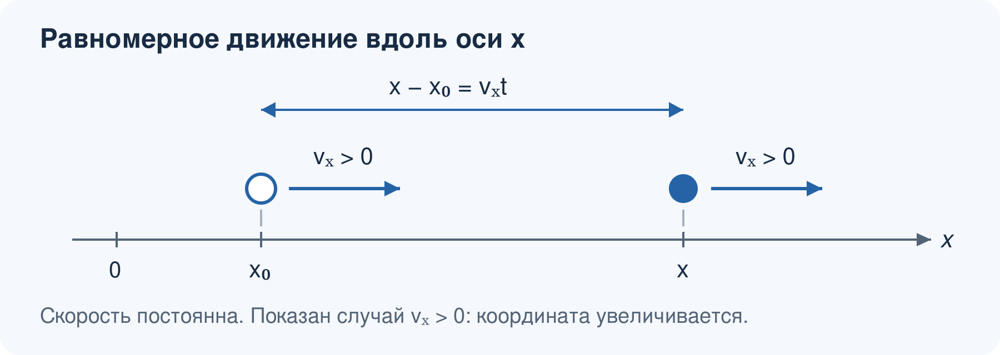
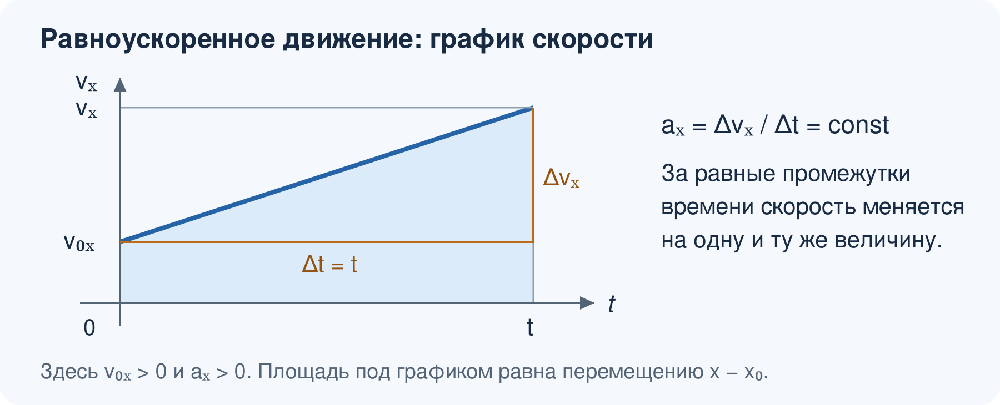

# Задание 1

Расчётная задача на равномерное и равноускоренное прямолинейное движение.

## Что нужно знать

### [Равномерное прямолинейное движение](../../../../physics-yakovlev.pdf#page=35)

$\displaystyle x=x_0+v_xt$

$\displaystyle v_x=\mathrm{const},\quad s=|v_x|t$

$x$ — координата тела, (м).  
$x_0$ — начальная координата, (м).  
$v_x$ — проекция скорости на ось, (м/с).  
$s$ — пройденный путь, (м).  
$t$ — время от начала движения, (с).

### [Равноускоренное прямолинейное движение](../../../../physics-yakovlev.pdf#page=37)

$\displaystyle v_x=v_{0x}+a_xt,\quad a_x=\frac{v_x-v_{0x}}t$

$\displaystyle x=x_0+v_{0x}t+\frac{a_xt^2}{2}$

$\displaystyle v_x^2-v_{0x}^2=2a_x(x-x_0)$

$x$, $x_0$ — конечная и начальная координаты, (м).  
$v_x$, $v_{0x}$ — конечная и начальная проекции скорости, (м/с).  
$a_x$ — постоянная проекция ускорения, (м/с²).  
$t$ — время движения, (с).

