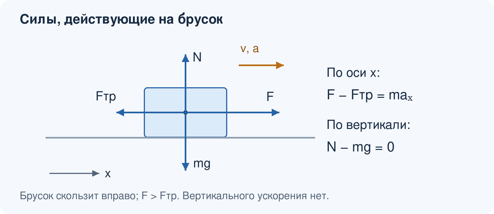
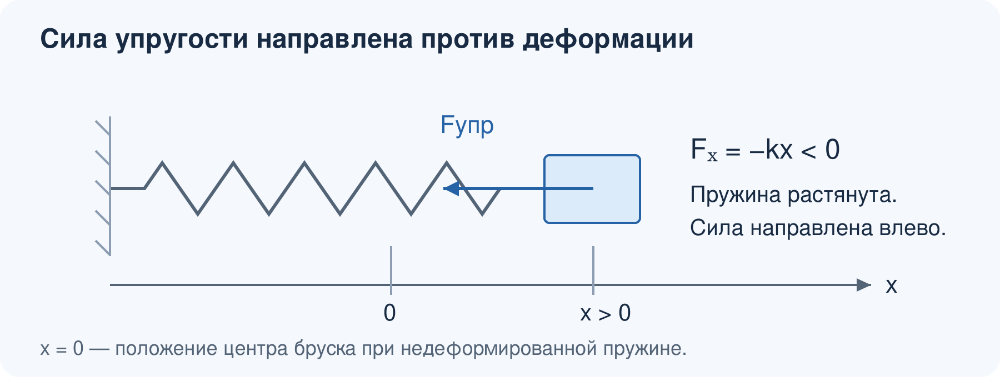

# Задание 2

Расчётная задача на законы динамики и действующие на тело силы.

## Что нужно знать

### [Второй закон Ньютона](../../../../physics-yakovlev.pdf#page=51)

$\displaystyle \sum\vec F=m\vec a$

$\sum\vec F$ — векторная сумма всех сил, действующих на тело, (Н).  
$m$ — масса тела, (кг).  
$\vec a$ — ускорение тела, (м/с²).

### [Закон всемирного тяготения. Сила тяжести](../../../../physics-yakovlev.pdf#page=56)

$\displaystyle F=G\frac{m_1m_2}{r^2}$

$\displaystyle F_{\text{тяж}}=mg$

$\displaystyle g=\frac{GM}{(R+h)^2}$

$F$ — сила взаимного притяжения тел, (Н).  
$G$ — гравитационная постоянная, (Н·м²/кг²).  
$m_1$, $m_2$ — массы взаимодействующих тел, (кг).  
$r$ — расстояние между точечными телами или центрами сферически симметричных тел, (м).  
$m$ — масса тела в поле тяжести, (кг).  
$g$ — ускорение свободного падения, (м/с²).  
$M$ — масса планеты, (кг).  
$R$ — радиус планеты, (м).  
$h$ — высота над поверхностью планеты, (м).

### [Сила упругости. Закон Гука](../../../../physics-yakovlev.pdf#page=54)

$\displaystyle F_x=-kx$

$F_x$ — проекция силы упругости на ось деформации, (Н).  
$k$ — жёсткость пружины, (Н/м).  
$x$ — удлинение или сжатие с учётом знака, (м).

### [Сила трения](../../../../physics-yakovlev.pdf#page=60)

$\displaystyle F_{\text{тр.ск}}=\mu N$

$\displaystyle F_{\text{тр.пок}}\leq\mu N$

$F_{\text{тр.ск}}$ — сила трения скольжения, (Н).  
$F_{\text{тр.пок}}$ — сила трения покоя, (Н).  
$\mu$ — коэффициент трения, (безразмерная величина).  
$N$ — сила нормальной реакции опоры, (Н).
